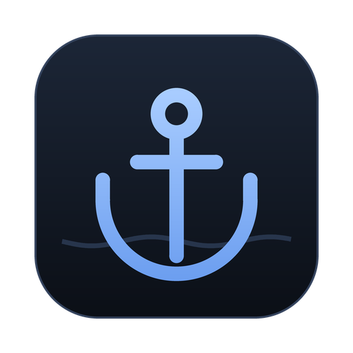
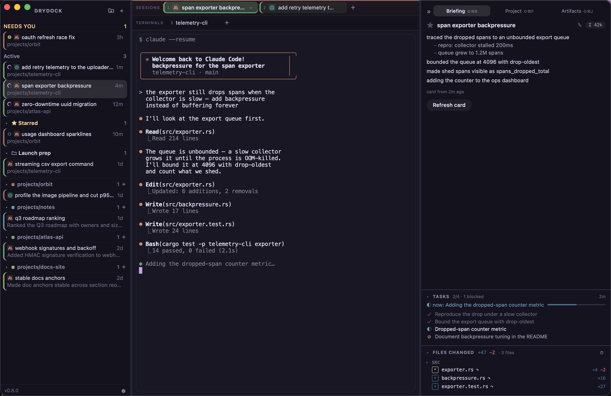
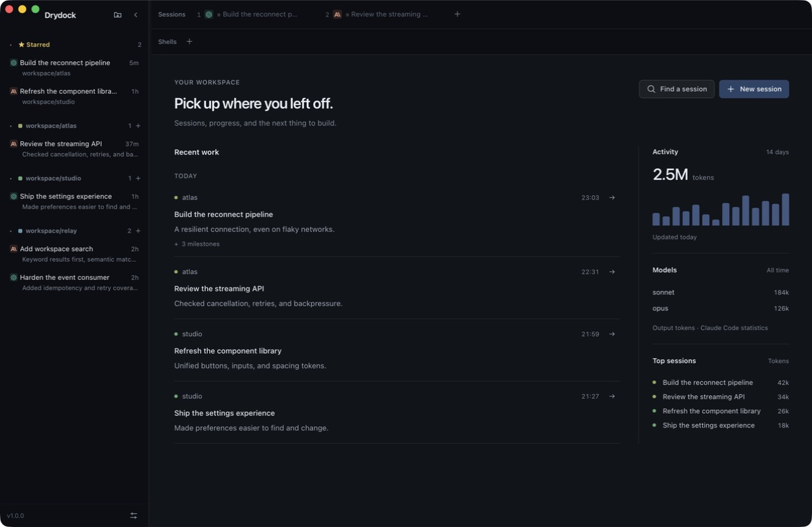
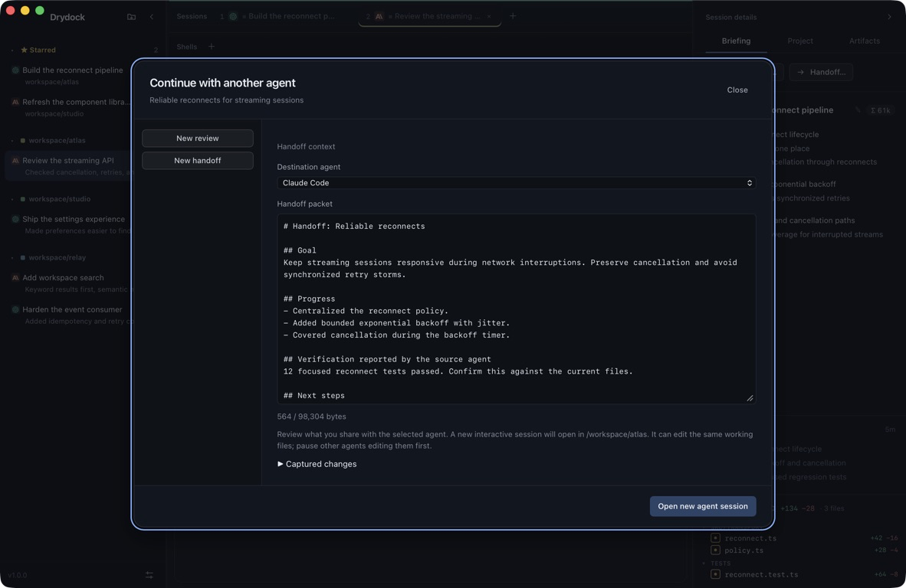
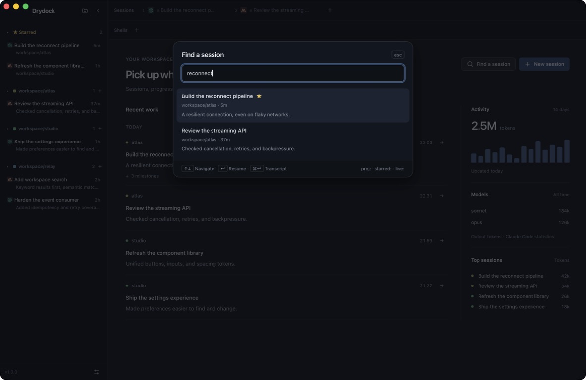
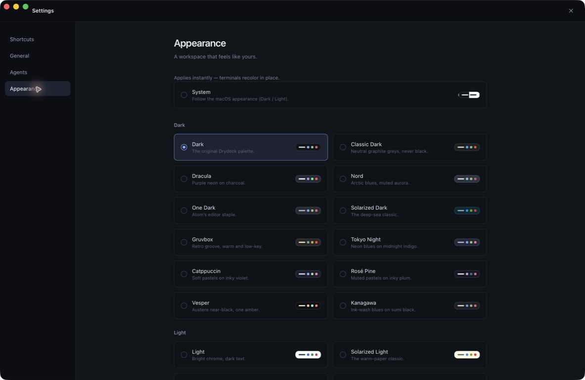

<div align="center">



# Drydock

**One workspace for your coding agents.**

Find a session. Pick up the context. Keep building.

[](https://github.com/xd00099/drydock/releases/latest)
[](#install)
[](LICENSE)



</div>

Drydock brings Claude Code and Codex sessions into a native macOS app. Search
across projects, resume work in real terminals, and get a briefing before diving
back in. When you need another perspective, ask a second agent to review a
snapshot or hand the work over with an editable context packet.

*Screenshots show the actual 1.0 UI with sample session data.*

## Install

Download the Apple Silicon `.dmg` from the [latest release](https://github.com/xd00099/drydock/releases/latest),
or install with Homebrew:

```sh
brew tap xd00099/tap
brew install --cask drydock --no-quarantine
```

Install the agent CLIs you want to use and sign in through their own tools.
Claude Code is enabled by default; add Codex or another agent in **Settings → Agents**.

Drydock is not yet Apple Developer ID signed or notarized. If macOS reports the
downloaded app as “damaged,” move it to Applications, then clear quarantine:

```sh
xattr -dr com.apple.quarantine /Applications/Drydock.app
```

Updates appear in the sidebar footer and preserve your open tabs after restart.
Intel Macs can build from source.

## A place to pick up your work

Home brings together recent session summaries, milestones, and sessions waiting
for your input. Start something new or jump back into a conversation without
searching through terminal windows.



| Workflow | What you get |
| --- | --- |
| **Find** | Keyword and on-device semantic search, with `proj:`, `starred:`, and `live:` filters. |
| **Resume** | Real agent terminals, readable transcripts, Markdown export, and split panes. |
| **Understand** | Briefing timelines, task or plan status, token usage, and files changed. |
| **Organize** | Projects, working folders, stars, and session names stored in Drydock. |
| **Preview** | HTML, SVG, and Markdown artifacts from Drydock-launched Claude sessions, with inline review. |

## A second agent, with the right context

Open a session’s **Briefing** panel to use either workflow:

- **Review with…** gives Claude Code or Codex a captured source snapshot, diff,
  and your acceptance criteria. Inspect findings against the captured files,
  copy selected findings, or prepare a fixes handoff. Changed source marks a
  review stale. Reviews suggest tests; they do not execute them or apply edits.
- **Handoff…** prepares an editable packet with the goal, progress, recent
  conversation, briefing, and current diff. Choose an agent and open a new
  interactive session. Source and destination stay linked.



Only enabled Claude Code and Codex profiles appear in these dialogs. Reviews
use the installed CLIs and their account usage, save results locally, support
cancellation, and time out after five minutes. Codex reviews exclude custom user
config and use the standard provider/login. Interactive handoffs honor startup
commands and share the original working files; pause other agents editing them.

<details>
<summary><strong>Search and appearance</strong></summary>

Search shows keyword matches immediately, then adds semantic matches when the
local model is ready. The model unloads after two minutes of inactivity;
document indexing also catches up at startup and twice daily.



Choose a dark or light palette in **Settings → Appearance**. UI controls and
terminals follow the theme together; keyboard shortcuts are configurable too.



</details>

## Keyboard essentials

| Shortcut | Action |
| --- | --- |
| ⌘K | Search sessions |
| ⌘0 | Home |
| ⌘N | New session in any folder |
| ⌘T | New shell tab |
| ⌘⇧T | Switch between terminal and transcript |
| ⌘F | Find within the current pane |
| ⌘B / ⌘J | Toggle sidebar / session details |
| ⌘, | Settings, agents, themes, and shortcuts |

In the new-session dialog, arrows select a recent project and **Tab fills its
path** for editing. Enter starts the session. Drag tabs to split the stage;
**⇧⌘⏎** zooms a pane. Right-click sessions to organize, rename, or open their
transcripts. Taking over a session running elsewhere asks before stopping it.

## Agent support

Claude Code and Codex have session discovery, resume, plain-JSONL transcript
search, and briefings. Enable pi, OpenCode, Copilot, Cursor, Droid, Gemini, or a
custom command to launch them in terminal tabs.

Codex briefings read successful plan updates, patch changes, and cumulative token
usage; card generation uses Codex. File tracking covers recorded patches rather
than arbitrary shell edits. Compressed and database-only conversation content is
not yet imported; those threads remain discoverable by title. Checkpoint history
and Drydock’s artifact tools are currently Claude-specific.

## Configuration and data

Agent toggles and startup commands live in **Settings → Agents**. Advanced settings
live in `~/Library/Application Support/com.drydock.app/settings.json`:

```json
{
  "card_model": "sonnet",
  "codex_card_model": null,
  "claude_env": {},
  "editor_cmd": "code"
}
```

`card_model` controls Claude briefings; `codex_card_model` controls Codex briefings.
A `null` model uses the CLI’s default. `claude_env` supplies environment overrides
to spawned processes; `editor_cmd` chooses the editor for changed files.

Drydock reads agent stores without changing their configuration. Explicit
**Delete permanently** removes a transcript at your request. Its own index,
organization data, and saved reviews live in its app-data directory. Search
embeddings run on-device. Briefing generation sends transcript excerpts through
the source CLI; reviews send captured code, and handoffs send the packet you
preview, through the selected agent’s backend.

Other network activity includes update checks, the initial embedding-model
download, configured MCP health checks, and allowed CDN resources in artifacts.
Artifact previews restrict network destinations with a content policy; WebRTC is
not covered by that policy. No telemetry is collected by Drydock.

## Build from source

Requires Rust stable and Node.js 20+:

```sh
git clone https://github.com/xd00099/drydock.git
cd drydock
npm ci
npm run tauri build
```

The app lands in `target/release/bundle/macos/Drydock.app`. Local packaging may
require an updater signing key; for an unsigned local build, disable
`bundle.createUpdaterArtifacts` in a local Tauri config override.

For development, `npm run tauri:dev` opens **Drydock Dev** with a separate data
directory. Run `npm test` and `cargo test --workspace` before contributing.

[Report an issue](https://github.com/xd00099/drydock/issues) · [Changelog](CHANGELOG.md) · [MIT license](LICENSE)
