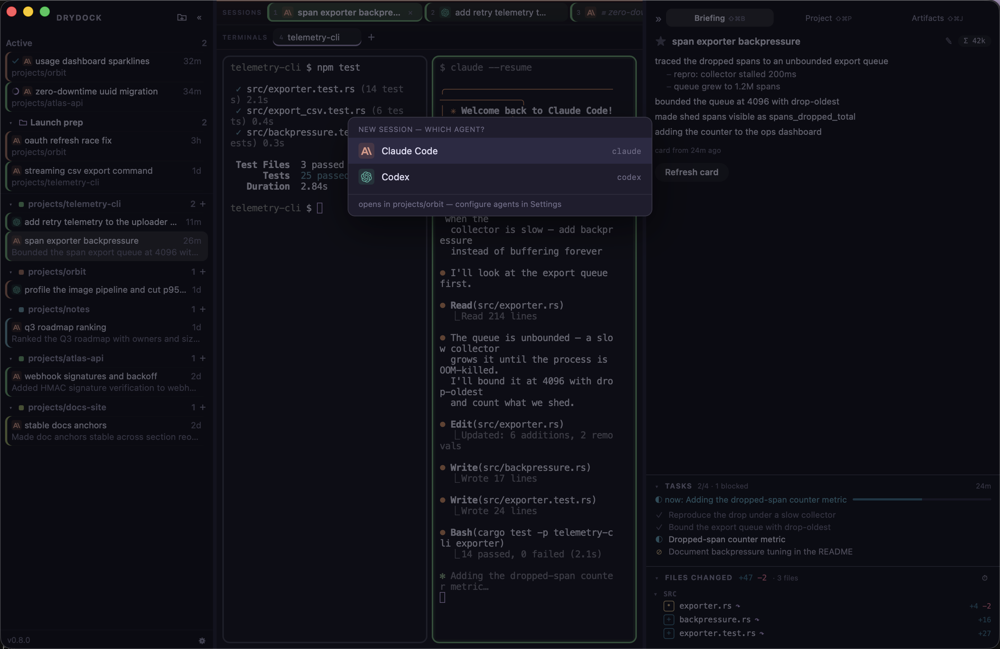
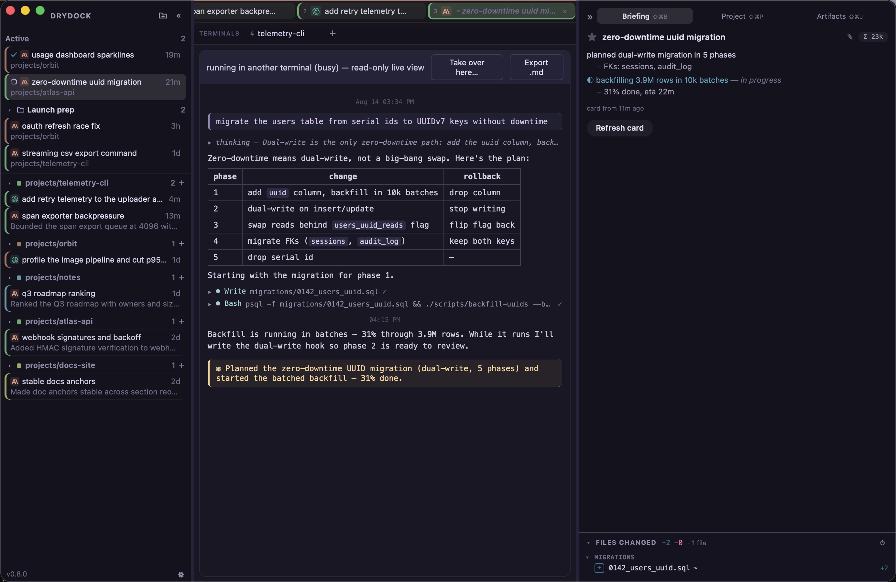
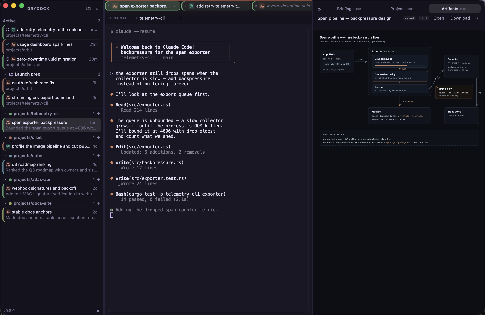
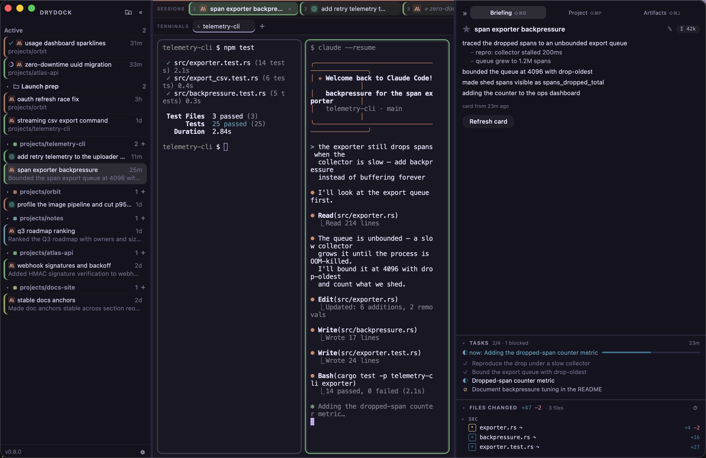
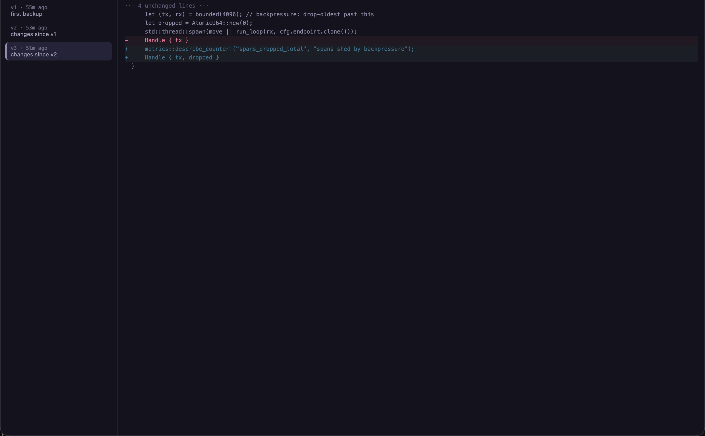
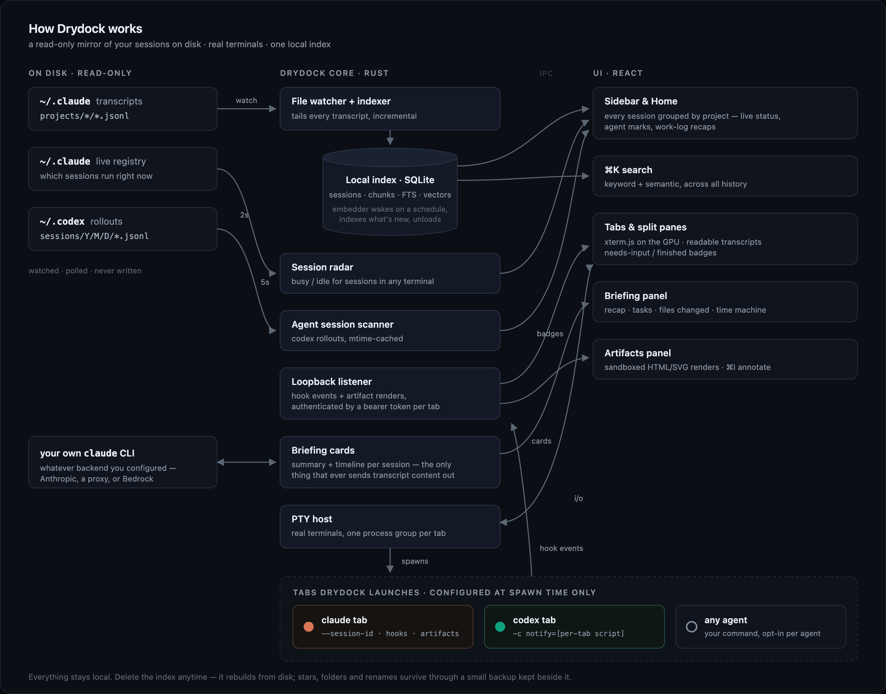

<div align="center">


# Drydock

**A home port for your Claude Code sessions — and the rest of your coding agents.**

Search your entire history, see what's running in *any* terminal,<br/>
and resume any session right where you left off — with an AI briefing of what happened.

[](#install)
[](https://v2.tauri.app)
[](https://claude.com/claude-code)
[](LICENSE)

<br/>


</div>

Claude Code writes every session to disk — but once you have dozens of them scattered across projects and terminal windows, they're easy to lose track of. Drydock indexes all of them into one native window: a **session radar** for what's live right now, **full-history search** for everything that came before, and a **real terminal** to pick any of it back up. And since your Claude sessions rarely live alone, it launches your other agents too — codex sessions get the same sidebar, resume, and turn-finished badges.

It never wraps an agent binary and — save an explicit right-click *Delete permanently* — never writes into `~/.claude` or `~/.codex`. It reads your transcripts, hosts real terminals, and keeps a local index; briefing cards run through your own `claude` CLI, while explicit review and handoff actions share captured code or context through your selected installed agent.

## Highlights

- **Full-history search (⌘K)** — keyword *and* semantic search across every session you've ever run, computed locally with an on-device embedding model (English and Chinese). Filter with `proj:`, `starred:`, `live:`.
- **Cross-project session radar** — every session in a sidebar, grouped by project with a per-project color chip, with busy / idle / needs-you states for anything running in *any* terminal — not just Drydock's own tabs. Sessions that want something from you float to the top in a NEEDS YOU block; the states are different *shapes*, not just colors, so they survive colorblindness.
- **Home** — the launchpad is a work log, not a blank page: an AI recap of what each session actually did, grouped by day, with the sessions waiting on your input pinned on top and a usage column (14-day activity, per-model cost, top sessions) alongside.
- **Agents beyond Claude** — enable codex, pi, opencode, Copilot, Cursor, droid, Gemini, or any custom command in Settings → Agents (strictly opt-in — out of the box only Claude Code is on). With more than one enabled, every new session first asks which agent to start. Every agent's launch command is yours to edit, Claude's included (`claude --your-flags`). Codex is first-class: its sessions appear in the sidebar with the OpenAI mark, resume with one click, and report "turn finished" through codex's own notify hook — injected per-launch, never written into `~/.codex`.
- **Notifications that mean what they say** — "finished" gets a quiet green check that clears when you look at it; a real question gets amber, a pulse and a sound; a turn killed by a rate limit says so. The dock badge counts questions only.
- **One-click resume** — reopens a session in its original working directory. A session that's already live somewhere else opens as a live read-only transcript — or **take it over**: Drydock names exactly what it will stop (pid, owning app, tty), asks, then resumes the session in its own tab.
- **Briefing cards** — an AI summary and milestone timeline for each session (generated through your own `claude` CLI), the session's live task board, and a **files-changed** panel with per-file `+/−` line stats. Summaries double as display titles, so cryptic first-lines become readable names.
- **File time machine** — browse Claude Code's per-edit checkpoints of every file the session touched: a version rail per file, before/after diffs, entirely read-only.
- **Split screen** — drag a tab onto the stage (or right-click a chip) to split it VS Code-style; panes wear their session's color, focus follows the pane (⌘⌥arrows), ⇧⌘⏎ zooms one to full stage.
- **Working folders** — drag sessions into folders that cut across projects ("Launch prep", "Research"), rename any session to whatever you call it in your head, and star the ones that matter — all stored in Drydock's index, never in `~/.claude`.
- **Readable transcripts** — open any session as a rendered document (markdown, collapsible tool calls and thinking, subagent transcripts), flip between a live terminal and its transcript with ⌘⇧T, search the whole conversation with ⌘F, export to markdown. Claude tabs run its own fullscreen TUI, which keeps no scrollback of its own — so the transcript, not the terminal, is where you scroll back and search.
- **Artifacts** — sessions launched from Drydock can render HTML, SVG, or Markdown into a side panel via a built-in loopback MCP server. Previews are saved per session into a local gallery.
- **Interactive review** — annotate a rendered artifact by clicking the element you mean (⌘I), send the notes back, and Claude applies them and re-renders. Plans get reviewed by pointing, not by describing.
- **Keyboard-first, your keys** — a new-session-in-any-folder dialog (⌘N, creates missing folders), panel and tab chords, and a Settings page (⌘,) where every binding is rebindable. Twenty themes — from Classic Dark to Gruvbox, Tokyo Night, Catppuccin, Rosé Pine and Kanagawa, with light counterparts — or follow the system.
- **A real terminal** — xterm.js on a PTY with GPU rendering and full IME support (pinyin included). It survives a lid-close (the GPU renderer re-arms itself after macOS purges it overnight), and quitting Drydock — ⌘Q, window ✕, or Dock → Quit — cleanly ends every session and shell it started. A close-tab guard makes sure muscle-memory ⌘W never kills a running turn.

## A quick tour

### Come back to a briefing, not a scrollback

Home is a work log of everything Claude did across every project — each session's recap grouped by day, expandable to its milestone timeline, with a ↗ jump straight into the session. Anything waiting on your input sits pinned at the top; the usage column keeps activity, per-model cost, and your heaviest sessions in view.


### Search everything you've ever done

⌘K searches your entire Claude Code history — every project, every session. Results fuse keyword matches with on-device semantic search, so "retry backoff" also finds the session where you called it "reconnect storm".


### Launch any agent, keep every session

Enable more agents in Settings → Agents and ⌘N asks which one to start — each with your own launch command. Tabs and sidebar rows wear the agent's mark, and the tab strip washes in the active agent's color, so a codex window never gets mistaken for a claude one. Codex sessions are discovered from disk like Claude's: they sit in the sidebar under their project, resume in a tab, and badge you when a turn finishes.



### Every session is a readable document

Sessions open as rendered transcripts: user and assistant turns, collapsible tool calls and thinking, subagent transcripts, timestamps. Live sessions tail in real time — read what a session is doing in another terminal without touching it, and if you want it, **Take over here** stops the terminal that owns it (it asks first) and resumes the session in Drydock.



### Sessions can show you things

Ask a session to render a diagram, a chart, or a mockup and it appears in the Artifacts panel — no browser round-trip. Hit ⌘I to annotate the render by clicking the element you mean; your notes go back to the session, which applies them and re-renders. Artifacts persist in a per-session gallery.



### Split the stage

Drag a tab chip onto the stage to split it — each pane wears its session's color, focus follows the pane, and ⇧⌘⏎ zooms one pane to the full stage and back.



### Rewind any file the session touched

The briefing panel's files-changed list opens into a time machine over Claude Code's per-edit checkpoints: pick a file, walk its versions, read the diff of each step. Entirely read-only — nothing gets restored behind your back.



### Make it yours

Every chord is rebindable with conflict detection (only ⌘1–9 stays fixed), and twenty themes ship in the box — the embedded terminals recolor in place.


## How it works



Drydock is a **read-only mirror**. A file watcher tails your transcripts into a local SQLite database (full-text index + vector embeddings — the embedding model wakes on a schedule, indexes what's new, and unloads); a 2-second poll of Claude Code's live-session registry powers the busy/idle radar, and a cached scan of `~/.codex/sessions` does the same for codex. Per-session hooks — injected only into tabs Drydock launches, via spawn-time flags, never by editing vendor config — flag sessions waiting on your input. It hosts PTYs so tabs are real terminals, but it never intercepts or wraps an agent CLI. Delete the index anytime — sessions and search rebuild from disk, and Drydock-side extras (stars, folders, renames) survive through a small backup file kept beside the database; only cached briefings regenerate.

## Install

**Requirements:** macOS on Apple Silicon (Intel: build from source), [Claude Code](https://claude.com/claude-code) on your `PATH`.

**Homebrew**

```sh
brew tap xd00099/tap
brew install --cask drydock
```

**Direct download** — grab the `.dmg` from the [latest release](https://github.com/xd00099/drydock/releases/latest).

Drydock isn't signed with an Apple Developer ID yet, so macOS quarantines the download and reports the app as **"damaged"** on first launch. It isn't — clear the quarantine flag and it opens normally:

```sh
xattr -dr com.apple.quarantine /Applications/Drydock.app
```

(or install with `brew install --cask drydock --no-quarantine`). Once running, Drydock checks GitHub Releases twice a day (or on demand — click the version in the sidebar footer) and shows an **Update** button that downloads and installs the new version in place; your open tabs — agent tabs included — are restored after the restart.

**Build from source** — needs Rust (stable) and Node 18+:

```sh
git clone https://github.com/xd00099/drydock.git
cd drydock
npm install
npm run tauri build
```

The bundle lands in `target/release/bundle/macos/Drydock.app`. For development, `npm run tauri:dev` runs as **Drydock Dev** with its own data directory, so it can live beside your daily install. Local builds sign with whatever Apple code-signing identity the machine has (a free "Apple Development" certificate from Xcode is enough), which keeps macOS folder-access grants stable across rebuilds.

## Everyday use

| Shortcut | Action |
|---|---|
| ⌘K | Search all sessions |
| ⌘0 | Go Home |
| ⌘N | New session in any folder (created if missing) — asks which agent when more than one is enabled |
| ⌘F | Find — the whole conversation in a transcript, the visible screen in a claude tab, full scrollback in a shell |
| ⌘⇧T | Toggle terminal ⇄ read-only transcript |
| ⌘T | New shell tab (inherits the active tab's directory) |
| ⌘W | Close the active tab (asks first only if that session is mid-turn) |
| ⌘D | Star / unstar the active session |
| ⌘B / ⌘J | Toggle sidebar / briefing panel |
| ⌘⇧B / ⌘⇧P / ⌘⇧J | Jump to the Briefing / Project / Artifacts tab |
| ⌘1–9 · ⌘⇧[ ] | Switch tabs |
| ⌘⌥←→↑↓ · ⇧⌘⏎ | Move focus between split panes · zoom a pane |
| ⌘, | Settings — rebind any of these (⌘1–9 stays fixed), pick a theme, enable agents |

Click a session in the sidebar to preview it (a single preview tab until you engage — typing in it keeps it). Drag a session onto a folder — or onto empty space in the folder band — to organize; right-click for the same moves plus rename, hide, delete, and transcript. Resuming an ended session reopens it in its original directory; a session live elsewhere opens read-only — or right-click → **Take over here** to stop the terminal that owns it and resume it in Drydock (it asks first). Quitting only asks when it would interrupt a turn actually in flight — idle sessions quit silently and come back on relaunch.

## Cross-agent review and handoff

Open an indexed session and expand its Briefing panel:

- **Review with…** captures working changes (or the last commit in a clean
  checkout) and asks Claude Code or Codex for an independent, read-only review.
  Supply acceptance criteria, inspect findings against captured source, and
  copy selected findings back to your builder or prepare a fixes handoff.
  Reviewers suggest reproductions; they do not run tests or apply edits.
- **Handoff…** prepares an editable context packet and opens a new interactive
  agent session in the source working directory. The packet includes the goal,
  recent conversation, briefing and working diff. The source session remains
  available, with links between the sessions after destination pairing.

Only enabled Claude Code/Codex profiles appear; enable Codex in **Settings →
Agents** if you only see Claude Code. Reviews use installed CLI binaries and
consume their account usage. Codex review jobs exclude custom user config and
use the standard provider/login; interactive handoffs honor startup commands.

Reviews persist under Drydock's app data, have a five-minute timeout, support
cancellation and allow two concurrent jobs. Interrupted reviews are not retried
automatically. Source changes mark results stale. Snapshot exclusions (binary,
large or symlinked files and harness configuration) are listed in the dialog.
Handoffs use the same working files; pause other agents editing them first.

## Configuration

**Agents** live in Settings → Agents: toggle on the ones you use, edit any launch command (Claude Code's included — `claude --your-flags` flows through new sessions, resumes, and post-update restores), add custom agents, and switch the window tint. Nothing is enabled by default except Claude Code, and enabling an agent never touches that agent's own config files. Agent names and marks belong to their respective vendors; Drydock isn't affiliated with or endorsed by any of them.

Drydock calls your own `claude` binary, so it inherits whatever backend you've configured — Anthropic, an OpenAI-compatible/LiteLLM proxy, or AWS Bedrock. An optional `settings.json` in `~/Library/Application Support/com.drydock.app/` tunes the rest:

```json
{
  "card_model": "sonnet",
  "codex_card_model": null,
  "claude_env": { "ANTHROPIC_BASE_URL": "http://localhost:4000" },
  "artifacts_enabled": true,
  "mcp_disabled": ["github"],
  "editor_cmd": "code",
  "agents_enabled": ["claude", "codex"],
  "agents_commands": { "codex": "codex --profile work" },
  "agents_custom": []
}
```

- `codex_card_model` — model used for Codex briefing cards (default `null`, using the Codex CLI configuration).
- `card_model` — model used for Claude briefing cards (default `sonnet`; set to `null` to use your CLI's default, e.g. on Bedrock/LiteLLM where the alias may not resolve).
- `claude_env` — environment variables injected into every process Drydock spawns. Handy when your endpoint is configured only in `~/.zshrc`, which non-interactive shells don't source. It's also the way to trade Claude's fullscreen TUI for the classic inline renderer, if you'd rather have real terminal scrollback in a claude tab: `"CLAUDE_CODE_DISABLE_ALTERNATE_SCREEN": "1"`.
- `artifacts_enabled` — inject the artifact-preview MCP server into sessions Drydock launches (default `true`).
- `mcp_disabled` — your MCP servers to hide from Drydock-launched sessions; also toggleable per server in the Project tab.
- `editor_cmd` — CLI used by "open in editor" in the files-changed list (e.g. `code`; default: the system opener).
- `agents_enabled` / `agents_commands` / `agents_custom` — the Settings → Agents page, in file form.

`card_model`, `codex_card_model`, and `claude_env` changes reach the next briefing card immediately; terminal tabs pick up `claude_env` on the next Drydock restart.

## Data & privacy

Everything stays local. Drydock reads `~/.claude` and `~/.codex` and never writes into them — with one explicit exception: right-click → *Delete permanently* removes that session's transcript, at your request. Its own index lives under `~/Library/Application Support/com.drydock.app/`, and embeddings run on-device. Briefing cards send transcript excerpts automatically through the source session’s CLI (`claude` or `codex`) to its configured backend. When you explicitly start a cross-agent review, the selected CLI receives captured source code and review instructions. Handoffs pass the context packet you preview and edit to the selected agent, whose configured backend may receive that content. Everything else on the wire is content-free: a twice-daily GitHub Releases version check, a one-time download of the ~110 MB embedding model on first launch, the MCP health check (your own `claude mcp list`, which contacts the servers you configured), and the libraries a rendered HTML artifact pulls from a fixed list of CDNs (jsDelivr, unpkg, cdnjs, Tailwind, Plotly, D3, Google Fonts). Past that list an artifact can't fetch, open a WebSocket, or load an image, video, font or stylesheet, so the ordinary ways of beaconing out what it renders are shut. One gap is left, named rather than glossed: WebRTC sits outside what a content policy can restrict in WebKit, so a deliberately hostile artifact could still use it. The visible trade-off: a remote `` inside an artifact won't load; ask the session to inline it instead. When Claude Code deletes a transcript under its retention policy, the session leaves Drydock too.

Codex plain JSONL rollouts use the shared transcript view, keyword/semantic index, stars, and briefing cards generated through Codex. The Briefing tab also reads the latest successful plan, successful patch file changes and line counts, and cumulative token usage without counting repeated usage events twice. File changes cover recorded patches; arbitrary shell edits cannot be attributed from a rollout. Claude’s file-history checkpoints remain specific to Claude sessions. Database-only threads remain discoverable and searchable by title; compressed and database-only conversation content is not yet imported.

Search shows keyword matches immediately, then enriches them using an on-demand local model. The model unloads after two minutes of inactivity. New document embeddings are still generated at startup and twice daily.

## Roadmap

- Codex history formats beyond plain JSONL rollouts (compressed and database-only transcripts)
- Hooks-based live status for sessions in other terminals (Drydock-launched tabs already use hooks; the registry poll remains for external ones)
- More first-class agents (pi and opencode are next in line)
- Windows / Linux support

Contributions welcome — open an issue or a pull request.

## License

[MIT](LICENSE)
